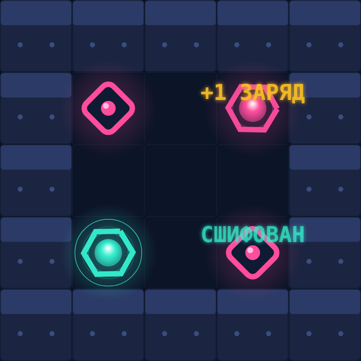
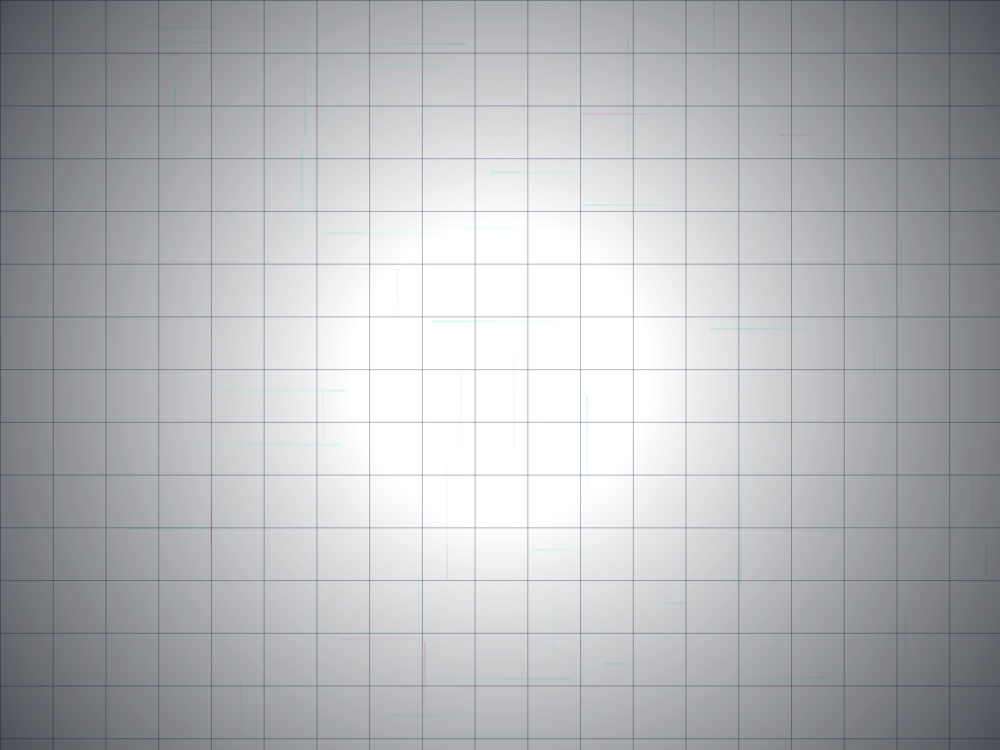
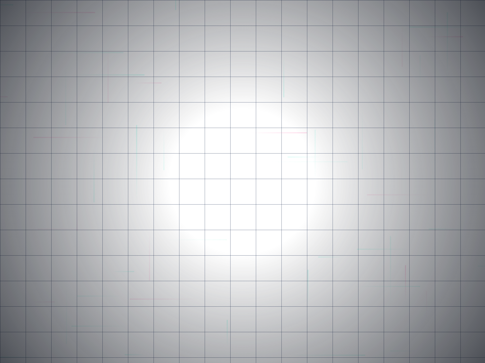
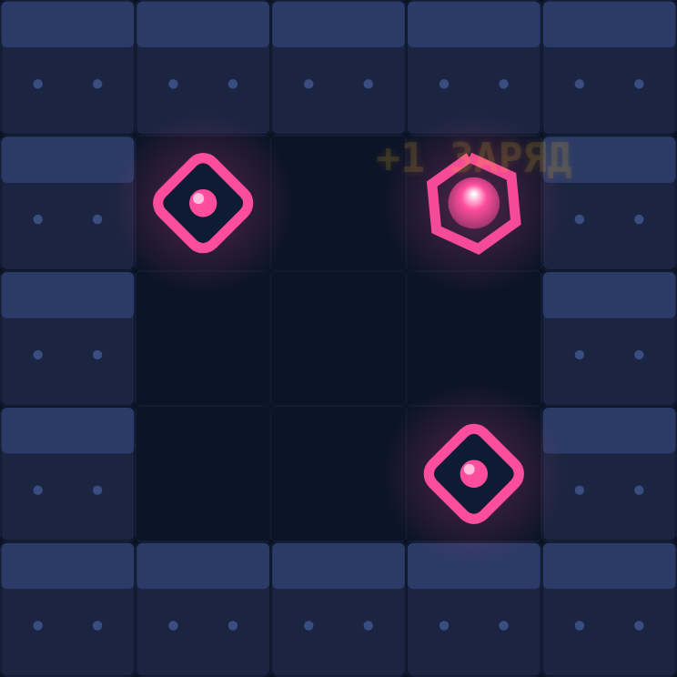

# РЕЗОНАНС — Дуэль Потоков

Абстрактная пошаговая тактика на выживание орбитального исполина **ТЕССИТ**. Ты — оператор, последний, кто помнит тактику. Против тебя — автономные протоколы машины. Чья память останется в эфире, решает не удача, а **профессионализм**: каждый ход — шахматно-чистый расчёт, каждый поток — нож, который можно повернуть против врага.

> Не шахматы и не «ещё один roguelike»: здесь нет фигур — есть **потоки, якоря, шлифовка и заряд резонанса**.



## Что внутри

- **Кампания 4×9 миссий** — сектора ТЕССИТА с лором, босс-протоколами и звёздами (★ за скорость, ★★ за победу без потерь).
- **Дуэль против ИИ** — 12 ботов-протоколов от Новичка (600 узлов) до Оракула (90 000 узлов/ход) с разными стилями (черепаха, агрессор, потокомант…).
- **Аркада** — 6 сценариев: блиц-сжатие, хаос-стрелки, двойное ядро, выживание и др.
- **Онлайн-дуэли** — комнаты по коду, быстрый подбор по рейтингу, **ELO-рейтинг** (K=32), таблицы лидеров, эмоции, реванш со сменой сторон.
- **Прогресс** — 10 рангов, 24 достижения, статистика, сохранение в localStorage.
- **Кодекс** — правила, юниты, управление и история ТЕССИТА.
- Полностью офлайн-режим: кампания, дуэли и аркада работают **без интернета**.

## Правила за 30 секунд

| Элемент | Смысл |
|---|---|
| **Ход** | одно действие: **ШАГ** на соседнюю клетку или **ТОЛЧОК** соседнего юнита (цепочка едет на 1 клетку) |
| **Шлифовка** | юнит, упёршийся в стену, разрушается → толкатель получает **+1 ЗАРЯД** (макс. 3) |
| **Поток** | после **каждого** действия юнит на стрелке едет ровно 1 клетку; **якорь** его держит |
| **Импульс** | потратить заряд: толчок на 2 клетки **сквозь тяжёлых** — включая шлифовку ядра |
| **Сжатие** | периметр сжимается кольцами: всё на кольце — в переработку |
| **Победа** | вражеское **Ядро** разрушено (шлифовкой, импульсом, искрой или сжатием) |

Управление: **ЛКМ** — выбор и цель · **H** — подсказка (ИИ) · **I** — импульс · **Esc** — снять выбор.

## Запуск (Windows)

1. Скачай **[РЕЗОНАНС-win64.zip](https://github.com/ritmiro1/Game3/releases/download/v1.0.0/%D0%A0%D0%95%D0%97%D0%9E%D0%9D%D0%90%D0%9D%D0%A1-win64.zip)**.
2. Распакуй и запусти **`РЕЗОНАНС.exe`** — один файл, без установки: встроенный сервер + весь клиент.
3. Откроется браузер с игрой. Для дуэлей в локальной сети — адрес печатается в консоли (`http://<IP>:8787`).

Консольное окно сервера можно закрыть только вместе с игрой.

## Скриншоты

| Меню | Кампания |
|---|---|
|  |  |

| Итог партии |
|---|
|  |

## Разработка

Стек: чистый **JavaScript** (движок, ИИ, клиент), **Node.js** (сервер: статика + собственный RFC6455 WebSocket + ELO), без внешних зависимостей в рантайме.

```bash
node server/server.js 8787      # сервер разработки (http://localhost:8787)

node js/test_engine.js          # движок: 31 тест
node js/test_ai.js              # ИИ: поиск, уровни, тактики
node js/test_content.js         # валидация 36 миссий, карт, баланса
node js/test_server.js          # комнаты, ELO, таймеры, реванш
node js/test_ui.js              # E2E интерфейса в jsdom (партия до конца)
```

**Сборка одиночного exe** (Node SEA):

```bash
# нужен node.exe win-x64 (например, из PyPI nodejs-wheel-binaries)
BLOB_NODE=/path/to/node-v24 node server/pack.js /path/to/node.exe
# результат: dist/РЕЗОНАНС.exe
```

### Архитектура

```
js/engine.js    — правила: террейн, юниты, шаг/толчок/импульс, фаза потока
                 после КАЖДОГО действия, сжатие по графику действий, хаос-стрелки
js/ai.js        — итеративное углубление + негамма + TT + qsearch,
                 бюджеты узлов (600…90 000) — честная сложность без «читерства»
js/content.js   — кампания, лестница ботов, аркада, достижения, кодекс, карты
js/render.js    — canvas-рендер: неон, частицы, плавные позиции, FX-очередь
js/ui.js        — контроллер: экраны, партия, бот (worker), онлайн, прогресс
js/net.js       — WS-клиент с переподключением
server/server.js— статика + WebSocket + комнаты/quick-match + ELO + таймер хода
```

## Лицензия

MIT. Игра создана как оригинальный концепт: «дуэль потоков» — пошаговая тактика, где всё зависит от чтения среды и точности расчёта.
